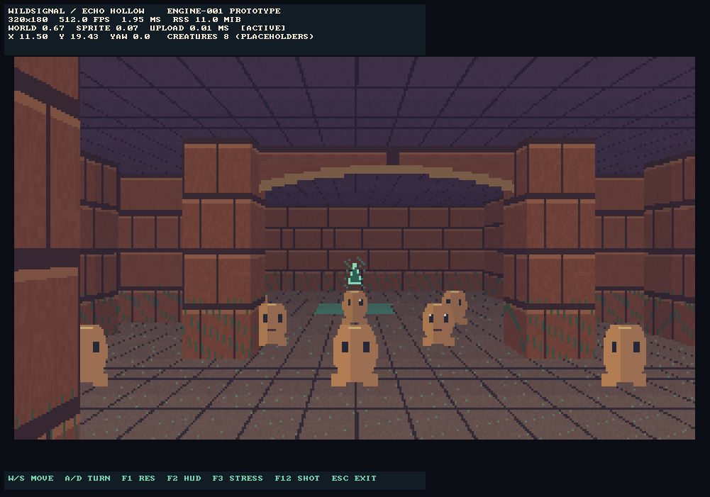
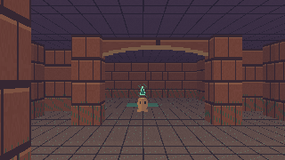
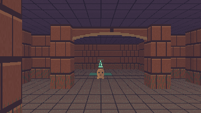
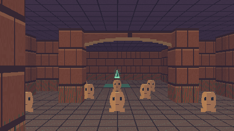
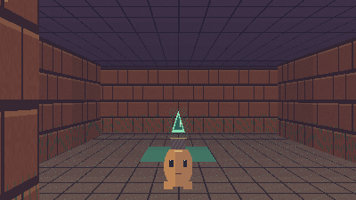

# ENGINE-001 implementation evidence

Status: **prototype implemented; acceptance pending owner hardware/visual tests**.
Source baseline: existing `feat/engine-001-echo-renderer` at
`40bed2de1325aa385b4d573122145beb7124a94a`, descended from the preproduction branch.
Issue: https://github.com/jonaslacandola0617/wildsignal/issues/3.
No original planning specification has been edited. Main/preproduction refs have
not been changed. Implementation permission is the owner's explicit ENGINE-001
instruction and Issue #3, superseding the older planning-only authorization text.

## Implemented

C++20, CMake, static SDL3 3.2.10; separate platform-neutral renderer/test runner
and SDL composition root. The exact 24×24 fixture is loaded and validated,
including actor IDs, closed borders, camera ranges and floor reachability.
W/S/A/D camera, bounded circle/wall collision, F1 resolution cycle, F2 UI toggle,
F3 one/eight creatures, focus reset, resize/letterboxing and F12 display capture.
CPU textured walls/floor/ceiling, pillar depth, cutout placeholder sprites,
decorative arch silhouette and emissive-looking signal cue. Crisp SDL debug HUD
is rendered independently of the ARGB8888 world buffer. Buffers are 230,400,
360,000 and 518,400 bytes. Six original 64×64 textures occupy 98,304 bytes.

Telemetry streams CSV and emits JSON on clean exit with nearest-rank p50/p95/p99,
FPS, simulation/world/sprite/UI/upload/present timing, build ID, configuration
groups, events and platform RSS/peak working-set methods. Unknown measurements
remain unknown. CPU-only headless timings explicitly exclude SDL/display costs.

## Local checks actually executed

Execution host: Linux x86_64, GCC **14.2.0** (Debian 14.2.0-19).
No Windows OS, Windows cross-compiler, SDL3 installation or CMake binary was
available locally. The shell's network proxy was unreachable. The existing
repository was imported via the GitHub connector as an exact shallow checkout;
all blob/tree/commit hashes were verified against the existing branch, including
its original +0800 commit timestamps. No unrelated repository baseline was used.

Run all core checks with:

```sh
bash tools/check_engine001.sh
```

This compiles Release (`-O2 -DNDEBUG -std=c++20`, warnings as errors), runs the
core tests and black-box export checks, then compiles/runs ASan+UBSan. Leak
detection defaults on; this managed host prevents LeakSanitizer's thread scan
(reported as a ptrace restriction). Here use `ASAN_OPTIONS=detect_leaks=0 bash
tools/check_engine001.sh`; leak detection must remain enabled on an unrestricted
host/CI. It uses no downloaded dependency and is not a substitute for CMake or
the native SDL build. Standard CMake core-only route on a suitably equipped host:

```sh
cmake -S . -B build/core -DENGINE001_BUILD_SDL=OFF -DCMAKE_BUILD_TYPE=Release
cmake --build build/core --parallel 2
ctest --test-dir build/core --output-on-failure
```

| Check | Local result |
|---|---|
| T001 fixture dimensions/bounds/coordinates/reachability | PASS |
| T002 cardinal/diagonal/swept collision, corner contacts, time-step cap | PASS |
| T003 actual pillar full/partial occlusion, front visibility, invalid projection | PASS |
| T004 exact allocations and initialized bounded pixels/depth at all three sizes and 24 yaws | PASS |
| T005 100 CPU buffer cycles, failed resize preservation, viewport math | PASS (SDL lifecycle separately gated) |
| T006 focus loss/resume, opposite-key cancellation, repeatable camera | PASS for typed input |
| T007 malformed/deep/oversized JSON, wrong geometry, missing fixture | PASS; art is generated so no missing image file dependency |
| T008 JSON/CSV counts, nearest-rank quantiles, unknown fields, overwrite protection | PASS |
| T009 offline headless boot | PASS with both HTTP proxies deliberately dead; no runtime network code exists |
| Hot render allocation audit | PASS: zero heap allocations across a warmed 360-degree stress sweep |
| SDL3 3.2.10 header/API syntax check | PASS with `g++ -fsyntax-only`, not linked or run |
| T010 Windows EXE/import inspection and SDL smoke | x64 Release compiled; 4/4 CTest cases passed on Windows CI at `4975a46`; final package/import evidence below; legacy runtime still untested |

The core suite has **200 assertions**. Local ASan+UBSan passed those assertions
with `detect_leaks=0`; LeakSanitizer itself could not execute because of the host
restriction. Linux CI (GCC 13.3.0, Ubuntu 24.04) configured/built with CMake and
passed **3/3 CTest tests**, ASan+UBSan and default leak checking enabled. Windows
CI (VS 2022 v143) configured/built x64 Release and passed **4/4 CTest tests**,
including actual SDL3 dummy-video/software rendering, three resolution cycles,
HUD/stress toggles, resize, focus reset and display readback. This is an automated
cloud Windows session, not the owner's Windows 11/i3 machine.

Initial CI run [39545913700](https://github.com/jonaslacandola0617/wildsignal/actions/runs/39545913700)
at `4975a46cb856aeb5a94840f234fcb91d388db4e7` failed **after** all Windows tests
passed: the checksum pipeline tried to hash its own open output file. The fix
collects the input file list before writing checksums, preserves documentation
paths in the package, and disables unused SDL subsystems/D3D12/Vulkan backends.
See the final package run evidence below for the corrected build.

The first size-reduction configuration (`c603361`) also exposed an SDL 3.2.10
link failure: `SDL_joystick.c` unconditionally references the virtual joystick
driver even with the joystick subsystem disabled. Default joystick/HIDAPI build
support was retained; these APIs are not initialized by the application.
At `94d8280a85ca0f50d9d24e1b850c0780b988f3e2`, Windows x64 compilation,
**4/4 tests**, installation, import records and SHA-256 generation/upload all
passed in [run 39546739801](https://github.com/jonaslacandola0617/wildsignal/actions/runs/39546739801).
The ZIP was 1,103,777 bytes. Linux CMake/sanitizer checks passed in that run too.
These build-system failures were corrected; no test failure is being hidden.

## Windows artifact and remaining device gate

The verified Windows toolchain is **MSVC 19.44.35229.0** (VS 2022 v143), static
SDL **3.2.10**, x64 Release. Windows CI is a hosted `windows-2022` environment,
not Windows 11 on the owner's hardware. The compiler patch is recorded, not
assumed pinned by the moving runner image. Full old-OS runtime/import audit is
still pending; generating PE import records does not certify Win7 compatibility.

Download the `engine001-windows-x64` artifact from the successful run, extract
it, open `out/engine001-windows-x64`, and run `wildsignal_engine001.exe` on
Windows 11 x64. Preserve `data`, `licenses`, `third_party` and `docs`. Import
and toolchain records plus dummy-video smoke reports are under `build/win` in
the artifact. Check `SHA256SUMS.txt` against the extracted files. Artifacts are
retained for 14 days; rebuild from the branch using the README after expiration.
No Steam client, SDL DLL or account is required.

The HUD adjustment at `700444e31bb84ecd6b4984d7c3677318f3929402` switches
to 1× text below 1200 output pixels wide, keeping the 1040-pixel 2× control legend
inside the smoke test's 1001-pixel resized window. This changes only the SDL HUD;
the core code used for the Linux measurements below is unchanged. Its final CI
result and actual composited display capture are recorded below. Inspection of
the first actual SDL image also caught SDL_RenderDebugText ignoring newline
controls; `23421ad` now draws four explicit statistics rows. All four Windows
tests passed after that fix. An evidence-export CSV pathname error (a trailing
dot from PowerShell's null-string conversion) was fixed using the report's
basename in `f31b587`; this did not change application code.

Final verified executable source: **`f31b587e954aef6fcfafc3762e902a0540fc6563`**.
[Run 39548472778](https://github.com/jonaslacandola0617/wildsignal/actions/runs/39548472778)
passed Windows x64 Release **4/4 tests**, installation, checksums and upload;
Linux CMake ASan/UBSan **3/3 tests** also passed. The subsequent evidence commit
changes documentation, capture tooling and measured artifacts only.

[Download the Windows x64 artifact](https://github.com/jonaslacandola0617/wildsignal/actions/runs/39548472778/artifacts/12322682190)
(1,219,008-byte ZIP; retained through 2026-11-04 UTC).
ZIP SHA-256: `cab7c42cf9b694fd3165ff082eac0dce9fc95803761b770ade8223dde79e8a0b`.
The artifact includes the executable, copied fixture, SDL license, documentation,
toolchain/import records, native JSON/CSV, BMP and lossless PNG display capture.

The actual SDL smoke session used the **dummy video driver/software renderer**,
1001×701 resized output, 36 uncapped frames and no warmup. It measured p95
**3.2123 ms** and peak working set **16.050781 MiB**, with configuration changes
and screenshot readback in the samples. This is functional cloud evidence,
**not** a sustained Windows 11 performance result. The [native JSON](results/windows-ci-sdl-smoke.json)
and [matching CSV](results/windows-ci-sdl-smoke_frames.csv) were extracted from
the actual CI output. CTest/build excerpts are in [the validation log](results/windows-ci-validation.txt).

Actual composited SDL output, inspected after fixing text layout:



## Actual short Linux measurements and images

Source/build: `4975a46cb856aeb5a94840f234fcb91d388db4e7`, GCC 14.2.0 Release,
`-O2 -DNDEBUG`, original exact fixture, stationary spawn, uncapped CPU-only
rendering, **120 frames per case, zero warmup**. The six captures each lasted
roughly 0.09–0.21 seconds. They demonstrate functioning instrumentation and
render output; **they do not meet the one-minute warmup/three-minute capture
protocol**, and establish no sustained target-device FPS. CPU model/RAM were not
collected. UI/upload/present are not run and are null in JSON/blank in CSV.

| World | Creatures | p50 ms | p95 ms | p99 ms | Peak Linux RSS MiB |
|---|---:|---:|---:|---:|---:|
| 320×180 | 1 | 0.705485 | 0.903890 | 1.125137 | 9.125 |
| 320×180 | 8 | 0.773806 | 1.226387 | 2.650397 | 10.000 |
| 400×225 | 1 | 1.176944 | 1.570006 | 3.280340 | 10.094 |
| 400×225 | 8 | 1.216021 | 1.694821 | 2.944603 | 10.367 |
| 480×270 | 1 | 1.598148 | 1.877852 | 2.034074 | 10.367 |
| 480×270 | 8 | 1.646559 | 1.983289 | 2.298916 | 10.605 |

Raw JSON and matching CSV are in [results](results/); memory uses
`/proc/self/statm` and `getrusage`, including renderer and instrumentation. An
extra single-frame near view at `(11.5,14.5)`, yaw 0, is image evidence only.
The original PPM buffers were losslessly encoded to PNG with
`python3 tools/capture_engine001.py build/direct/wildsignal_engine001_headless`.
That script never paints or resamples the rendered image. Use a fresh output
directory/run prefix to recapture; existing evidence is protected from overwrite.

Actual headless world output (no SDL/HUD in these images):









The far/near marker and signal scale correctly; pillars clip some stress sprites
at the image edge. The arch reads as a silhouette from the start view and looks
flat/absent from the reverse/side view. Owner creative signoff is **NOT REVIEWED**.

## Limits and recommendation

Walls have one height (3.2 fixture units), level floor/ceiling and zero pitch.
The arch is a camera-facing cutout trim at (12,12.5), not an opening in wall
geometry; it can look flat or turn unnaturally from the side. Binary alpha cards
are sorted by camera depth and clipped against wall columns. No intersecting
nonparallel transparent planes, translucent blending, stacked rooms, slopes,
partial-height walls, real dynamic lights, animation assets or audio are provided.
Telemetry excludes minimized intervals, but focus-only background rendering can
remain in a capture and is annotated with events. A forced process kill may
leave incomplete CSV without JSON. The screenshot key overwrites the previous
display BMP within the same run; use distinct run names for a screenshot set.
The optional scripted walk/turn sequence can stop at walls and is collision
stress, not a representative acceptance walkthrough. Use manual input for that
test. Windows narrower than 640 pixels can clip the full debug legend.

No actual owner PC, Windows 7/8/8.1/10/11 interactive session or Android device
was tested locally. No 30 FPS target-hardware or minimum-RAM claim is established.
The Windows CI job builds x64 Release, runs dummy-video SDL lifecycle smoke and
records PE imports/toolchain; it cannot prove interactive visuals, old-OS startup
or integrated-GPU performance. Import review and real legacy OS testing remain
required even with `_WIN32_WINNT=0x0601` and static SDL/CRT.

Recommendation: obtain the Win11 i3/4GB walkthrough and visual review before
expanding to town/forest or choosing a production renderer. If tall arch/side-view
fidelity fails owner review, compare a small sector renderer using the same scene;
do not hide grid-raycaster limits by adding more game systems. This is an
engineering recommendation, **not** a ratified renderer ADR.

Windows instructions, controls and packaging are in [README.engine001.md](../../README.engine001.md).
No production gameplay, multiplayer, accounts, battles, full AI, inventory,
quests, saves, progression, payments, Steamworks, Play services, additional
regions, owner art or creature catalog was added. Issue #3 must remain open until
the prescribed real-device and visual gate is satisfied.
