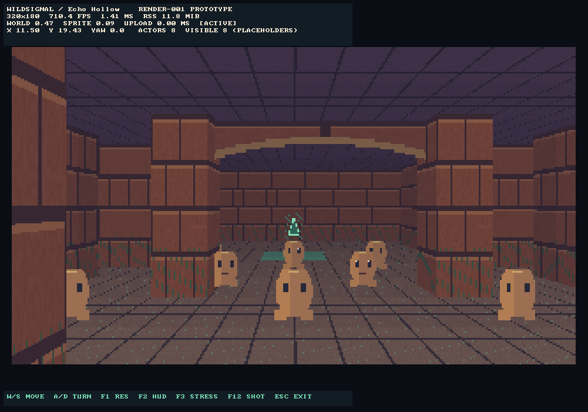
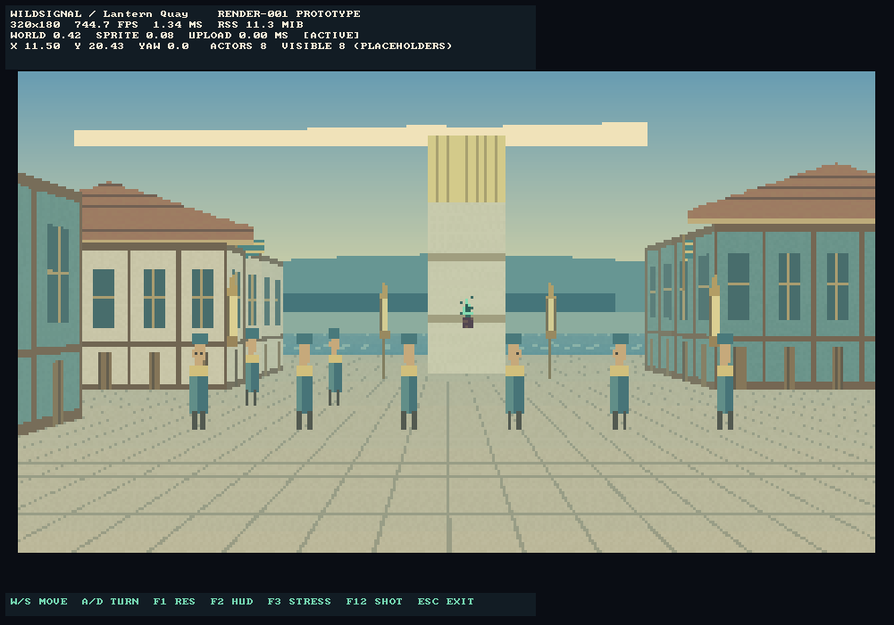
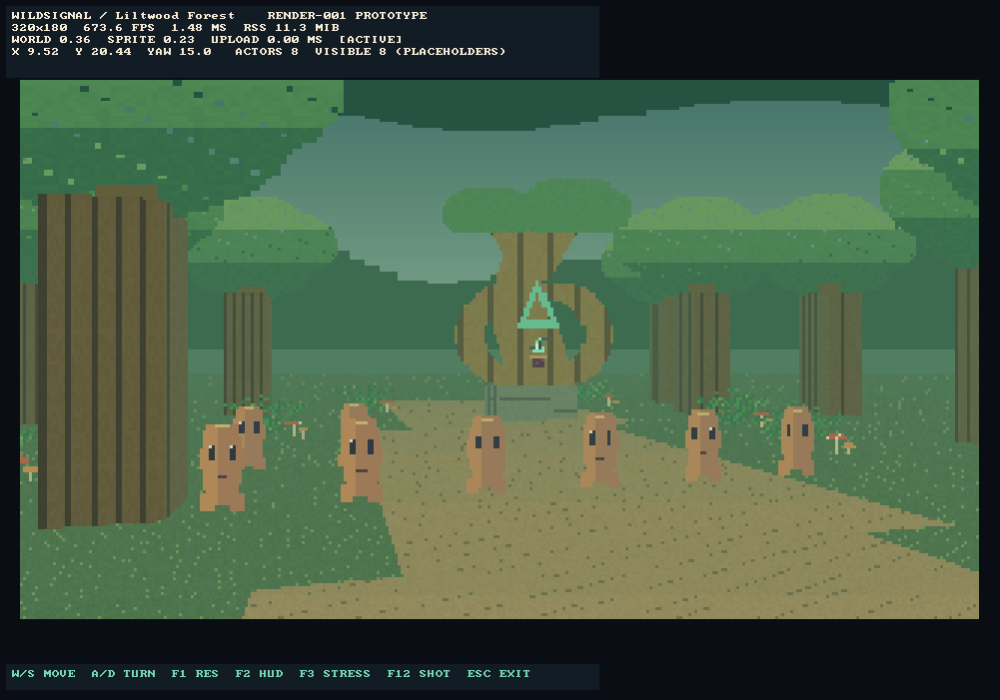

# RENDER-001 implementation and validation

Status: implementation ready for review; device and creative acceptance pending on `feat/render-001-three-scenes`, based on ENGINE-001 `f647bb1691d31ef050e10950a375d15cd86e726e`. ENGINE-001 owner acceptance covers the initial Windows 11 experience only. Sustained performance, minimum specifications, Windows 7 and Android remain pending.

## Implemented

The existing software grid raycaster now loads independent 24×24 Lantern Quay and Liltwood micro-fixtures alongside the unchanged Echo Hollow fixture. CLI `--scene echo|quay|forest|FILE` selects them. Original programmer art supplies coastal skies, distant scenery, timber facades, roof cutouts, a beacon, lanterns, generic NPCs, forest canopy cutouts, trunks, ferns, mushrooms and a Singing Root silhouette with mint signal glyph. Original private species art was neither accessed nor published.

Outdoor views use the same grid DDA, extended to walk beyond lower foreground surfaces to taller distant surfaces. Ground remains one plane. Outdoor per-pixel depth handles elevated scenery and cutout cards above low surfaces. Echo retains its original wall-column occlusion and exact 1/8 actor color rendering. Existing W/S and A/D controls, collision, nearest-neighbor scaling, HUD, resolutions and telemetry remain.

The 1/8/24 actor pools are separate from scenery. CSV records submitted cards, final visible actors, candidate pixel tests, opaque writes and final sprite pixels. These distinguish population from visibility and expose cutout/overdraw cost. `creatures` retains its legacy field name and means requested generic actors, including NPCs. Camera rotation and wall/card occlusion can reduce visibility. JSON includes scene identity, median/P95/P99 frame times, component timings and measured process memory; unmeasured target-device properties remain null.

## Architecture assessment and limitations

This extension can demonstrate a legible harbor square and layered forest clearing at small resolutions. It does not settle the production renderer choice. Rectangular building blocks, axis-aligned trunks and a single floor remain visible constraints. Roofs, canopy masses and the Singing Root are camera-facing cutout illustrations: they rotate toward the camera, have no solid roof surface and can intersect walls or each other from side views. Equal-depth card intersections have no geometric resolution. No pitched camera, slopes, bridges, walkable upper floors, mesh architecture, true arches, portals, shadows, dynamic lighting or blended transparency exist. Elevated props do not add collision; trunk/building/rock grid cells do. Water and perimeter boundaries are invisible colliders. Sky silhouettes are decorative and cannot be reached.

Leaf/fern cutouts use binary alpha, opaque depth writes and back-to-front sorting; this avoids blended foliage artifacts but produces hard pixel edges. Sway only moves complete cards. Signal glow is painted/pulsed art, not illumination. Water only scrolls a small texture. There is no navigation, interaction or AI. Actor stress pools are static.

Texture storage is fixed at 655,360 bytes. At 480×270 the color, float-depth and ownership arrays plus column depth use 1,170,240 bytes (color upload alone 518,400 bytes). They allocate at resolution changes, not per frame. The fixed telemetry reservation is additional process memory. Original Echo also reserves the outdoor depth/ownership buffers; this is an explicit memory regression to measure, not a claim of equal memory use. The new allocation audit covers both outdoor scenes at every resolution/population across twelve rotations; the retained Echo audit covers a 72-angle, eight-actor sweep.

A future RENDER-002 comparison is justified if approved production scenes require irregular footprints, stable roof geometry, indoor/outdoor connections or vertical traversal. This task adds no second renderer and makes no final architecture selection.

## Validation record

Local GCC 14.2.0 Release: existing 200 checks and black-box export tests passed. Existing ASan/UBSan checks passed with `detect_leaks=0` because this managed execution environment cannot run LeakSanitizer's process tracing. The 479 new checks, including 24 exact Echo pixel goldens, passed in GCC Release, local ASan/UBSan and MSVC Release. The local fallback script completed successfully. Direct local commands are in `tools/check_engine001.sh`; CMake/Windows instructions are in `README.render001.md`. The local host has no installed CMake or SDL runtime, so SDL execution and Windows compilation run in CI.

CPU-only results exclude texture upload, UI and presentation. The owner's Windows 11 60+180-second/device validation remains pending for each scene. No Android package, Windows 7 claim, minimum hardware claim or thermal result is supplied. No production gameplay or online systems were added. PR #4 and the protected baseline branches remain unmerged and unchanged.

### Automated builds

- Source `b83b06b5872ada6d1851fdd67e9ef73a4333d0ab`: [Windows x64 and Linux sanitizer CI](https://github.com/jonaslacandola0617/wildsignal/actions/runs/39555477747), both successful. Windows: **7/7 CTests**, including all three SDL lifecycle scenes. Linux: **4/4 CTests** with ASan/UBSan and default leak detection. The 27-case CPU matrix also passed on Windows. MSVC reported no C++ compiler warnings after the explicit conversion cleanup.
- Local fallback: `ASAN_OPTIONS=detect_leaks=0 bash tools/check_engine001.sh`, GCC 14.2.0, Release plus ASan/UBSan: existing **200** checks, new **479** checks and black-box JSON/CSV, offline, CLI, malformed-fixture and duration tests passed. SDL code was additionally checked with `g++ -fsyntax-only` against the pinned SDL headers. Sanitizer execution is separate from Release performance capture.
- [Windows artifact](https://github.com/jonaslacandola0617/wildsignal/actions/runs/39555477747/artifacts/12324809821): portable executable, data, SDL license, documentation, uncompressed CI frame streams, toolchain/import report and SHA256SUMS. Artifact ZIP digest: `sha256:2845829f9bce635dbc2538780be730a5af470ac1ae41979e72412ceec6cedbd0`; GitHub retention ends 2026-11-04. This is an unsigned development build, not an installer or compatibility certification.

### Actual screenshots

These are Windows x64 SDL software-renderer readbacks from the hosted CI VM with the dummy video driver, not mockups or images from the owner's PC. Each capture is 1001×701 after a tested resize; the world is nearest-neighbor integer-scaled with letterboxing and the HUD remains at display resolution. The HUD's uncapped FPS is a short CI smoke number and must not be treated as low-end device performance. JSON/CSV beside each PNG contains the matching complete 36-frame lifecycle run (mixed resolutions and 1/8 actors).

| Echo Hollow regression | Lantern Quay | Liltwood Forest |
|---|---|---|
|  |  |  |

### Stationary CPU matrix

All three scenes × three resolutions × 1/8/24 requested actors were executed for 60 uncapped frames each on the managed Linux container. This is short smoke evidence without warmup, not sustained acceptance or a renderer ranking. Full per-run JSON is in [render001/linux_matrix](render001/linux_matrix), the summary is [linux_matrix.csv](render001/linux_matrix.csv), and all 27 raw CSV streams are in [linux_matrix_frames.tar.gz](render001/linux_matrix_frames.tar.gz). Host identity and fixture SHA256 hashes are recorded in [linux_context.json](render001/linux_context.json). The container reports an AMD EPYC 9V74 CPU, a two-CPU quota and an 8 GiB memory limit; it is not the i3/4 GB target.

Representative **480×270 / 24 submitted actors** measurements:

| Scene | Final visible actors | Median ms | P95 ms | P99 ms | World P95 ms | Sprites P95 ms | Peak RSS MiB |
|---|---:|---:|---:|---:|---:|---:|---:|
| Echo | 17 | 2.109 | 2.547 | 3.561 | 2.006 | 0.614 | 10.25 |
| Quay | 24 | 1.629 | 1.910 | 2.155 | 1.524 | 0.417 | 10.25 |
| Forest | 24 | 2.955 | 3.104 | 5.856 | 1.885 | 1.227 | 10.25 |

Quay and Forest each retain all 1/8/24 actors in the final stationary image at every resolution. Echo retains all 1/8 but only 16–17 of 24 at its unchanged hero camera because of its arch/pillars and mutual occlusion. It is not presented as a 24-visible-actor case.

At this resolution/population Forest submits 40 scenery + 24 actor cards. A representative frame visits 127,675 candidate sprite pixels, makes 51,281 opaque writes and leaves 42,339 final sprite pixels: about 1.21 opaque writes per final pixel. Candidate visits include transparent holes and depth rejections. Quay submits 13 scenery + 24 actors, visits 54,844 candidates, makes 15,954 writes and leaves 15,219 pixels. These counters expose the forest's extra cutout/sorting/overdraw work; they do not measure GPU overdraw. Values come from the matching P95 counters in the stationary JSON reports; each stationary run has a fixed composition.

### Open acceptance gates

| Gate | Status |
|---|---|
| Existing engine behavior and exact Echo image regression | Automated checks passed on GCC/MSVC |
| Three environments load, collision, cutout/depth/sorting, allocation audit | Automated checks passed |
| Windows x64 compilation and SDL lifecycle | CI passed; hosted software/dummy display only |
| Outdoor visual identity and acceptable billboard/geometry compromises | Owner review pending |
| Actual Windows 11 i3/4 GB 60+180-second capture and 20-minute sustained run | Pending |
| Accelerated SDL display/presentation on owner GPU | Pending |
| Windows 7/8/8.1/10 and Android runtime/performance | Not tested; no Android package in this scope |
| Minimum specifications, mobile input, thermals, leak trend over long soak | Unestablished |
| RENDER-002 sector/portal comparison or final renderer selection | Separate future authorization/decision |

The timer's `standardTimingProtocolMet` field only checks warmup/capture duration; it does not approve device, visual, sprite-visibility or 30 FPS gates. The current walkthrough is the retained generic forward/360-degree-turn pattern and can settle against collision geometry; it is not a hand-authored tour of each zone. Stationary matrix results supply the full outdoor stress population; walking captures can have zero visible actors for part of a turn.

No source story map, original Echo fixture, pre-production branch, main branch or ENGINE-001 branch was modified by this PR. No gameplay, companion AI, inventory, save, battle, account, monetization or online subsystem was added. Original creature assets remain private. Controls are unchanged; Issue #5 remains deferred.

### Longer timed CPU captures

The three runs below executed **sequentially**, each with 60 seconds warmup followed by at least 180 seconds of recorded frames at 480×270 / 24 submitted actors / 30 FPS cap / scripted forward movement and full turns. Reports retain the actual measured source SHA `b3444c5`; they are not relabeled as a later build. The local CPU source predates only explicit conversion cleanup, HUD wording and additional duration tests. Raw JSON and gzip-compressed CSV are committed beside the screenshots. Quantiles and sample counts were independently checked against all raw frame rows; no samples were dropped at capacity.

| Scene | Samples | Capture seconds | Median ms | P95 ms | P99 ms | World P95 ms | Sprite P95 ms | Peak RSS MiB | Actors visible median / max |
|---|---:|---:|---:|---:|---:|---:|---:|---:|---:|
| Echo | 5378 | 180.050 | 33.466 | 33.537 | 33.639 | 2.983 | 0.176 | 10.25 | 0 / 23 |
| Quay | 5376 | 180.044 | 33.468 | 33.570 | 33.791 | 1.976 | 0.242 | 10.25 | 0 / 22 |
| Forest | 5375 | 180.025 | 33.470 | 33.581 | 33.816 | 1.666 | 0.582 | 10.25 | 0 / 3 |

All three meet the **timing duration** protocol. Their P95 frame times exceed the plan's strict **33.3 ms** screening threshold with the current completion-to-completion sleep cap. **That screening threshold is not passed.** This is not an i3 hardware finding: these captures include sleep/scheduling and CSV I/O on the managed EPYC host and omit SDL/UI/upload/present. They neither establish nor disprove target-device viability. The generic walking pattern frequently faces collision walls or looks away from the actor pool, yielding zero median visible actors. Consequently these long runs are timing/path evidence; the shorter stationary matrix above is the full-population overdraw evidence. A standardized stationary/full-population run and a representative manual walk on the owner's actual Windows 11 device remain required before performance acceptance.

Each scene's `processPeakRssMiB` is an OS measurement for that process. It is not an installed-RAM minimum, Android PSS, a leak-trend finding or a 20-minute thermal test. The benchmark plan's platform/device/soak gates remain pending.
